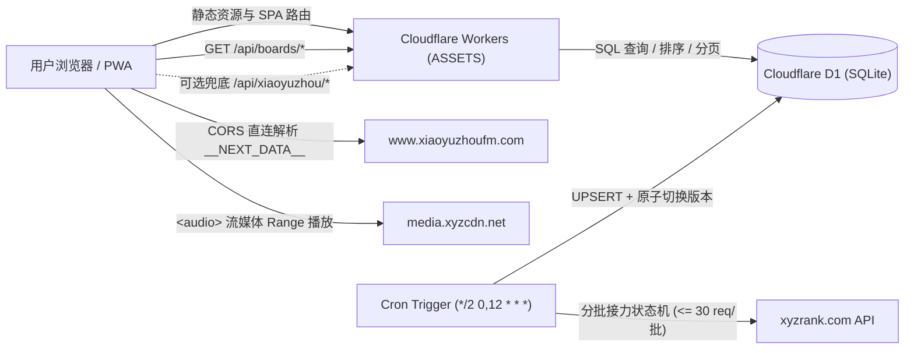

# XYZ Podcast · 小宇宙热榜收听端

> 基于 [xyzrank.com](https://xyzrank.com/) 热门榜单数据与 [xiaoyuzhoufm.com](https://www.xiaoyuzhoufm.com/) 公开内容构建的**移动端优先、兼顾 PC 端**播客发现与在线收听 Web 应用（支持 PWA 添加到主屏幕）。
> 后端运行于 **Cloudflare Workers + Cloudflare D1 (SQLite)**，前端采用**零构建 CDN Vue 3 (Options API)**。

---

## 核心特性

- **四大热门榜单（D1 持久化 + 毫秒级筛选 + 虚拟滚动 + 趋势标识）**
  - **热门节目** (`/`) · **热门播客** (`/hot-podcasts`) · **新锐节目** (`/hot-episodes-new`) · **新锐播客** (`/new-podcasts`)
  - 服务端 SQL 关键词搜索、Apple Podcast 分类筛选、多指标白名单排序（含中位数参考）与触底无限加载；接口启用按版本隔离的边缘缓存与预聚合分类，降低 D1 读取消耗。
  - **排名升降趋势 & 快捷穿透**：对比上一期榜单展示 `↑ / ↓ / 新(NEW)` 趋势标识；单集榜支持直接点击播客名进入所属 `/podcast/:pid` 频道页，并同步展示 `已听 XX% / 已播完` 进度标签。
  - **固定顶栏 & 虚拟滚动**：顶部导航栏全局固定定位并动态适配内容区顶部留白；首页榜单移动端卡片与桌面端表格均采用基于实测行高的虚拟滚动（仅渲染视口及缓冲区条目），支持数千条已加载榜单流畅浏览。
  - **无刷新返回体验 & 深链友好**：榜单与频道页通过 Vue `<keep-alive>` 保留已加载条目与垂直滚动位置；外链直达单集/频道页自动提供「逛热榜首页」回退与顶栏「热榜」入口。
- **站内播客频道与单集播放页（实时按需抓取）**
  - **播客频道页** (`/podcast/:pid`)：频道简介（展开/收起）、订阅与总集数、最新 15 集列表，支持单集播放/入队或「全部加入队列」。
  - **单集播放页** (`/episode/:eid`)：直跳所属播客频道、付费/试听提示、`DOMPurify` 净化的 **Shownotes** 及 **热评区（含二级回复）** —— 两者均支持点击文内 `MM:SS` / `HH:MM:SS` 时间戳一键空降跳播。
- **全局常驻播放器与断点续播**
  - 单一 `<audio>` 实例驱动底部迷你播放器与展开全屏播控页，逛榜单、看频道不断播。手机迷你栏保留播放和队列，点击标题/封面展开完整播控。物理/浏览器返回优先关闭队列和全屏播放器，再次返回才离开页面；音频持续播放。
  - **节目简介**：长 Shownotes 默认折叠并渐隐预览，点击「展开完整节目简介」查看全文；短简介完整展示，展开后可点击文内时间戳跳转播放。
  - 微信内按设计字号显示，不跟随微信的文字缩放；普通浏览器保持原有行为。
  - 点击顶栏左侧 Logo 可查看项目介绍、数据来源与 [GitHub 源码](https://github.com/icheer/xyz-podcast)，支持返回键、Esc 或点击遮罩关闭。
  - 手机榜单列表可左滑切换下一个榜单、右滑切换上一个，首尾不循环；切换榜单不增加后退步骤，详情返回仍回到刚才的榜单和滚动位置。纵向浏览及控件操作保持原有行为。
  - 手机搜索通过顶栏搜索图标展开；详情页精简顶栏，桌面榜单支持「更多指标」。播放器、队列与页面过渡支持系统「减少动态效果」，弹层支持 Escape、焦点限制与关闭后焦点恢复。
  - 支持 **后退 15 秒 (`-15s`) / 前进 30 秒 (`+30s`)**、**0.9x – 2x 的 8 档倍速**、**顺序播放 / 列表循环 / 单曲循环**、**睡眠定时器（15/30/45/60 分钟 · 播完本集自动停 + 音量渐弱）**，以及 `navigator.mediaSession`（含 `setPositionState` 锁屏进度同步）。
  - **播放列表抽屉**：集成 `SortableJS` 触摸/鼠标拖拽排序 + 下一首插队 / 上移 / 下移 / 置顶 / 清除已播完 / 清空队列，手机端按内容自适应高度、桌面端侧栏；单删、清已播与清空均支持 5 秒内一键撤销；音频直链过期时自动重抓刷新。
  - **免登录「我的收听」中心 & 开放备份**：无需注册账号即可在榜单、频道页或单集页一键**关注播客**（榜单同步展示 `已关注` 标识），集中查看**收听历史**并一键续播；支持一键导出/合并恢复 **JSON 收听备份**，以及导出标准 **OPML 2.0 订阅文件**（含 RSS `xmlUrl`）无缝迁移至泛用型播客客户端。
  - **PC 桌面端全局快捷键**：非输入状态下支持 `Space` 播放/暂停、`←` / `→` 快退 15 秒 / 快进 30 秒、`[` / `]` 调节倍速、`M` 静音切换、`/` 快速聚焦榜单搜索框。
  - **`localStorage` 持久化** (`xyzp_v1_*`)：自动保存关注列表、播放队列、偏好设置与最近 200 集收听进度，刷新或下次打开自动断点续播。
- **PWA 沉浸式体验**：内置 `site.webmanifest`、安全区分导航与静态资源的网络优先 `sw.js`、矢量及多尺寸图标（`192/256/512`）与零闪白深/浅色双主题（支持首次跟随系统主题）。

---

## 部署到 Cloudflare（推荐：Fork 后关联 GitHub）

**不需要在自己电脑上安装 Node.js、Wrangler，也不需要在终端登录 Cloudflare。** 在 GitHub 和 Cloudflare 网页完成一次配置后，向部署分支提交代码即可自动更新。Cloudflare 原生 [Workers Builds](https://developers.cloudflare.com/workers/ci-cd/builds/) 支持新建 Worker，也支持为已有 Worker 关联仓库。

### 1. Fork 仓库并准备自己的数据库

1. 在 GitHub [Fork 本仓库](https://github.com/icheer/xyz-podcast/fork)。
2. 在 Cloudflare 控制台进入 **存储和数据库 → D1 SQL 数据库**，创建名为 `xyz-podcast-db` 的数据库，复制它的 **Database ID**。详见 [D1 官方入门文档](https://developers.cloudflare.com/d1/get-started/)。
3. 在自己的 Fork 中，通过 GitHub 网页编辑 `wrangler.toml`：将 `database_id` 换成刚复制的 ID，然后提交。仓库当前的 ID 属于原作者的数据库，不能用于其他账号。

需要确认的配置如下（只修改对应字段，保留文件中其他配置）：

```toml
name = "xyz-podcast" # 必须与稍后创建的 Worker 名称一致，可改为自己的名称

[[d1_databases]]
binding = "DB" # 保持不变，程序通过这个名称访问数据库
database_name = "xyz-podcast-db"
database_id = "替换成你自己数据库的 ID"
migrations_dir = "migrations"
```

数据库名称保持 `xyz-podcast-db`，这样可以直接使用仓库现有的迁移脚本。此时无需手动建表，下一步会自动初始化。

### 2. 新建 Worker，关联自己的 Fork

在 Cloudflare 控制台进入 **Workers 和 Pages → 创建应用 → 连接 GitHub 仓库**，授权访问自己的 Fork，然后选择该仓库。选择 **Workers** 部署方式，按下表填写：

| 设置 | 填写内容 |
|---|---|
| Worker 名称 | 与 `wrangler.toml` 的 `name` 完全一致，默认 `xyz-podcast` |
| 生产分支 | `main`（或你实际使用的部署分支） |
| 根目录 | 仓库根目录，通常保持默认 |
| 构建命令（Build command） | 留空；本项目没有前端构建步骤 |
| 部署命令（Deploy command） | `npm run db:migrate:remote && npm run deploy` |

命令只需粘贴到 Cloudflare 的配置框，由 Cloudflare 执行。它会先应用尚未执行的 D1 迁移，再发布 Worker 和 `public/` 静态资源；后续部署不会重复执行已完成的迁移。参见 [构建配置](https://developers.cloudflare.com/workers/ci-cd/builds/configuration/) 与 [D1 迁移说明](https://developers.cloudflare.com/d1/reference/migrations/)。

**部署令牌需要包含 D1 权限。** 在构建设置的 **API token** 中选择具备目标账号 `Workers Scripts:Edit` 和 `D1:Edit` 等所需部署权限的令牌。Cloudflare 自动创建的构建令牌默认权限列表未包含 D1；可在 **个人资料 → API Tokens** 编辑该令牌、保留原有部署权限并补上 **Account → D1 → Edit**，或创建具有相应权限的令牌后在构建设置中选择它。详见 [Workers Builds 令牌权限](https://developers.cloudflare.com/workers/ci-cd/builds/configuration/#api-token)。令牌不需要写进仓库。

点击 **保存并部署**。成功后访问控制台提供的 `workers.dev` 地址。以后向生产分支 `git push`，或直接在 GitHub 网页编辑并提交，都会触发自动部署；在 Worker 的 **部署 / Builds** 中查看结果。

### 3. 等待首次榜单同步

部署成功后，先打开 `https://你的域名/api/health` 确认服务和数据库连接正常。**数据库建表成功不代表已有榜单数据**：首次使用需等待北京时间下一次 `08:00` 或 `20:00` 的定时同步，通常再过约 12 分钟完成全量发布。接近同步窗口末尾才部署时，若这一轮未完成，下一窗口会发起新一轮同步。

Cron 已写在 `wrangler.toml` 中，部署时一并配置，无需自己每天操作。初次设置或变更 Cron 可能需要最多 15 分钟传播，参见 [Cron Triggers](https://developers.cloudflare.com/workers/configuration/cron-triggers/)。希望立即灌入数据的进阶用户，也可配置下面的 `ADMIN_KEY` 后调用管理 API。

### 现有 Worker 改为 Git 推送部署

已经用命令行部署过的用户，**直接连接现有 Worker，无需删除或重建 Worker、数据库**：

1. 确认准备关联的仓库里，`wrangler.toml` 的 `name` 与现有 Worker 名称相同，`database_id` 仍指向当前正在使用的 D1 数据库。
2. 打开 **Workers 和 Pages → 现有 Worker → 设置 → Builds → Connect**，关联自己的 GitHub 仓库与生产分支。
3. 使用上方相同的构建、部署命令和令牌权限配置；已有 D1 迁移只会执行尚未应用的部分。
4. 向该分支提交一次变更，在 Builds 中确认该次提交部署成功，再检查原网址、`/api/health`、数据库绑定和定时任务。后续更新直接推送代码即可。

域名、现有数据库和数据可继续使用；仓库配置需与现有资源一致，已有 `ADMIN_KEY` 等运行时密钥也应在设置中核对。官方步骤见 [Connect an existing Worker](https://developers.cloudflare.com/workers/ci-cd/builds/#connect-an-existing-worker)。

### 可选：管理员密钥与抓取兜底

只用定时同步和网页收听，无需配置 `ADMIN_KEY`。如需手动触发同步，在 Worker 的 **设置 → Variables and Secrets** 添加类型为 **Secret** 的 `ADMIN_KEY`，保存并部署；调用 `/api/admin/sync*` 时通过 `X-Admin-Key` 携带它。此项是 **Worker 运行时密钥**，不是 Builds 的构建变量或部署 API Token，参见 [Secrets](https://developers.cloudflare.com/workers/configuration/secrets/)。

| 变量名 | 控制台配置位置 | 用途 |
|---|---|---|
| `ADMIN_KEY` | Worker → 设置 → Variables and Secrets → Secret | 可选：手动同步及同步状态接口鉴权 |
| `XYZ_RELAY_URL` | Worker → 设置 → Variables and Secrets | 可选：外部 HTML 转发地址，浏览器直连小宇宙失败时的后端兜底 |
| `XYZ_RELAY_TOKEN` | Worker → 设置 → Variables and Secrets → Secret | 可选：转发服务的 `X-Relay-Token` |

普通使用可不配置转发服务；如将非敏感变量写入 `wrangler.toml` 的 `[vars]`，请保持仓库与控制台配置一致。

### 确认定时同步是否完成

在浏览器打开 `/api/boards/meta`。北京时间 `20:00` 这一轮对应当天 `YYYYMMDDT12`，`08:00` 对应 `YYYYMMDDT00`；当 `syncVersion` 为目标版本、`isComplete: true`，且四榜 `syncedCount` 都等于 `total`，即表示完整发布成功。已有完整旧版本时，这里仍展示旧版，不能只看更新时间来判断新一轮是否完成。

想看同步中的进度或失败原因，可进入 **D1 → 该数据库 → Console** 执行以下只读 SQL，无需本地终端：

```sql
SELECT run_id, status, current_board, current_offset, retry_count,
       last_error, started_at, finished_at
FROM sync_runs ORDER BY started_at DESC LIMIT 5;

SELECT value AS active_sync_version
FROM app_state WHERE key = 'active_sync_version';
```

`status = completed` 且 `active_sync_version` 等于该 `run_id` 表示发布成功。`running` 表示仍在分批接力，`failed` 时查看 `last_error`。数据库时间为 UTC，北京时间需加 8 小时。也可以使用携带 `X-Admin-Key` 的 `GET /api/admin/sync/status` 查询。

<details>
<summary>可选：使用本地终端部署（开发者）</summary>

完成下方本地开发的依赖安装后，按需运行：

```bash
npx wrangler login
# 仅首次创建数据库；已存在时复用，不要重建
npx wrangler d1 create xyz-podcast-db
# 将自己的 database_id 填入 wrangler.toml
npm run db:migrate:remote
# 仅需要管理 API 时设置
npx wrangler secret put ADMIN_KEY
npm run deploy
```

自动部署用户无需执行这些命令。首次数据同步与完成判定方式同上。

</details>

---

## 系统架构



### 关键工程设计

1. **兼容 Cloudflare Free Plan 的分批接力同步 (`src/db/sync.js`)**
   - `xyzrank.com` 4 个接口单页上限为 100 条（全量约 9,100+ 条，合计 ~93 页），超出 Workers Free Plan 单次 50 次外部请求上限。
   - 采用单一 Cron 窗口 `*/2 0,12 * * *`（北京时间 `08:00` 与 `20:00` 起每 2 分钟触发），配合 D1 `sync_runs` 状态机每批仅拉取 15 页，约 12 分钟完成全量同步后原子切换 `active_sync_version`，同小时其余 Tick 零外部请求直接退出。
2. **浏览器直连 CORS 抓取 + 共享解析器 (`public/js/xyzParser.js`)**
   - `www.xiaoyuzhoufm.com` 会拒绝携带 Cloudflare Workers 自动注入的 `CF-Worker` 请求头的出站请求（`403`），但对浏览器端简单 `GET` 请求动态回显 `Access-Control-Allow-Origin`。
   - 前端直接请求小宇宙官网并由与后端共享的 `public/js/xyzParser.js` 解析 `__NEXT_DATA__`，同时在后端保留 `/api/xiaoyuzhou/*`（支持可选 `XYZ_RELAY_URL` 转发）作为兜底通道。

---

## 目录结构

```text
xyz-podcast/
├── AGENTS.md                 # 跨会话架构规范与数据契约
├── CHECKLIST.md              # 实施清单与交接日志
├── CLAUDE.md                 # Claude Code 入口指引
├── package.json              # npm 脚本与 wrangler 依赖
├── wrangler.toml             # Workers、D1、Static Assets 与 Cron 配置
├── .dev.vars.example         # 本地密钥模板
├── migrations/
│   └── 0001_init.sql         # D1 初始化建表迁移脚本
├── src/
│   ├── index.js              # Worker fetch() 与 scheduled() 入口
│   ├── db/
│   │   ├── schema.js         # D1 版本状态与批量写入辅助函数
│   │   └── sync.js           # xyzrank 分批接力同步状态机
│   ├── handlers/
│   │   ├── admin.js          # /api/admin/sync* 管理端同步接口
│   │   ├── boards.js         # /api/boards/* 榜单查询与元信息接口
│   │   └── xiaoyuzhou.js     # /api/xiaoyuzhou/* 可选后端转发解析接口
│   └── utils/
│       ├── http.js           # JSON 响应、ID 校验与参数工具
│       └── parser.js         # 重导出 public/js/xyzParser.js
├── public/
│   ├── index.html            # SPA 入口（CDN Vue 3 Options API + unpkg 依赖 + PWA meta）
│   ├── site.webmanifest      # PWA 清单
│   ├── sw.js                 # Service Worker（静态壳网络优先）
│   ├── icon.svg / icon*.png  # 应用图标（SVG + 192 / 256 / 512 PNG）
│   ├── css/app.css           # 移动优先双主题样式系统
│   └── js/
│       ├── xyzParser.js      # __NEXT_DATA__ 提取与清洗纯函数
│       ├── api.js            # 前端数据请求与浏览器 CORS / 后端兜底封装
│       ├── storage.js        # localStorage 队列、关注播客、收听历史、JSON 备份与 OPML 导出
│       ├── utils.js          # 格式化、时间戳解析、虚拟窗口计算、快捷键守卫、scrollKeeperMixin
│       ├── app.js            # Vue 3 根实例、VueRouter、全局音频引擎与快捷键控制
│       └── components/       # AppIcon / AboutDialog / LibraryDrawer / RankBoard / PodcastView / EpisodeView / PlayerBar / PlaylistDrawer
└── test/                     # Node 内置 test runner 单元测试
```

---

## 本地开发

### 1. 安装依赖与配置环境变量

```bash
npm install
cp .dev.vars.example .dev.vars
# 编辑 .dev.vars 设置本地 ADMIN_KEY，例如 ADMIN_KEY=local-dev-admin-key
```

### 2. 初始化本地 D1 数据库并启动

```bash
# 应用本地 D1 迁移
npm run db:migrate:local

# 启动开发服务器（含 --test-scheduled 可选）
npm run dev
```

### 3. 本地灌入榜单测试数据

启动 `npm run dev` 后，可循环调用管理端同步接口将 `xyzrank.com` 数据拉取到本地 D1：

```bash
for i in $(seq 1 8); do
  RESP=$(curl -sS -X POST "http://127.0.0.1:8787/api/admin/sync" \
    -H "Content-Type: application/json" \
    -H "X-Admin-Key: local-dev-admin-key" \
    -d '{"maxPages":15}')
  echo "$RESP"
  echo "$RESP" | grep -q '"done":true' && break
done
```

或测试 Cron 调度入口（需使用 `npm run dev:scheduled` 启动）：

```bash
curl "http://127.0.0.1:8787/__scheduled?cron=*/2+0,12+*+*+*"
```

### 4. 运行单元测试

```bash
npm test
```

---

## API 概览

| 方法与路径 | 鉴权 | 说明 |
|---|---|---|
| `GET /api/health` | 无 | Worker 与 D1 连通性健康检查 |
| `GET /api/boards/meta` | 无 | 返回当前同步版本、更新时间及 4 榜单分类列表 |
| `GET /api/boards/:board` | 无 | 查询榜单（支持 `offset`、`limit`、`q`、`genre`、`sort`、`dir`） |
| `GET /api/xiaoyuzhou/podcast/:pid` | 无 | 播客频道页解析兜底接口 |
| `GET /api/xiaoyuzhou/episode/:eid` | 无 | 单集播放页解析兜底接口 |
| `POST /api/admin/sync` | `X-Admin-Key` | 手动触发单批接力同步 |
| `GET /api/admin/sync/status` | `X-Admin-Key` | 查看历史同步批次与状态 |

---

## 已知边界与致谢

- 受限于小宇宙官网未登录网页端公开数据：播客频道页仅展示最新 **15 集**，单集页仅展示精选热门评论（约 **20 条**），网页端不提供逐字稿正文；所有详情页均保留「去小宇宙官网」直达链接。
- 榜单统计数据来自民间项目 [中文播客榜 (xyzrank.com)](https://xyzrank.com/)，播客音频与节目元信息版权归原播客制作方与 [小宇宙 (xiaoyuzhoufm.com)](https://www.xiaoyuzhoufm.com/) 所有。
