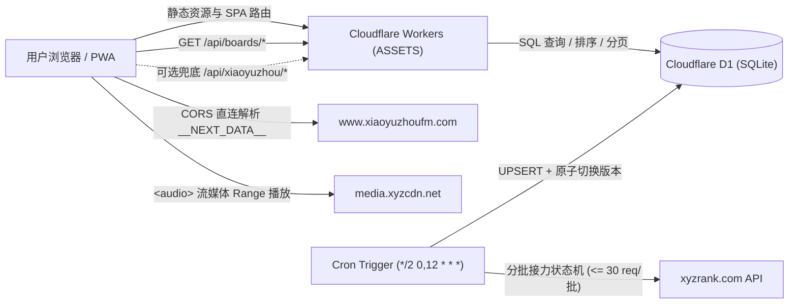

# XYZ Podcast · 小宇宙热榜收听端

> 基于 [xyzrank.com](https://xyzrank.com/) 热门榜单数据与 [xiaoyuzhoufm.com](https://www.xiaoyuzhoufm.com/) 公开内容构建的**移动端优先、兼顾 PC 端**播客发现与在线收听 Web 应用（支持 PWA 添加到主屏幕）。
> 后端运行于 **Cloudflare Workers + Cloudflare D1 (SQLite)**，前端采用**零构建 CDN Vue 3 (Options API)**。

---

## 核心特性

- **四大热门榜单（D1 持久化 + 毫秒级筛选 + 虚拟滚动）**
  - **热门节目** (`/`) · **热门播客** (`/hot-podcasts`) · **新锐节目** (`/hot-episodes-new`) · **新锐播客** (`/new-podcasts`)
  - 服务端 SQL 关键词搜索、Apple Podcast 分类筛选、多指标白名单排序（含中位数参考）与触底无限加载。
  - **固定顶栏 & 虚拟滚动**：顶部导航栏全局固定定位并动态适配内容区顶部留白；首页榜单移动端卡片与桌面端表格均采用基于实测行高的虚拟滚动（仅渲染视口及缓冲区条目），支持数千条已加载榜单流畅浏览。
  - **无刷新返回体验**：榜单与频道页通过 Vue `<keep-alive>` 保留已加载条目与垂直滚动位置，从详情页返回列表不重置、不丢失滚动进度。
- **站内播客频道与单集播放页（实时按需抓取）**
  - **播客频道页** (`/podcast/:pid`)：频道简介（展开/收起）、订阅与总集数、最新 15 集列表，支持单集播放/入队或「全部加入队列」。
  - **单集播放页** (`/episode/:eid`)：直跳所属播客频道、付费/试听提示、`DOMPurify` 净化的 **Shownotes**（支持点击 `MM:SS` / `HH:MM:SS` 时间戳及小宇宙原生 `data-timestamp` 直接跳播）、置顶与二级回复热评区。
- **全局常驻播放器与断点续播**
  - 单一 `<audio>` 实例驱动底部迷你播放器与展开全屏播控页，逛榜单、看频道不断播。手机迷你栏保留播放和队列，点击标题/封面展开完整播控。物理/浏览器返回优先关闭队列和全屏播放器，再次返回才离开页面；音频持续播放。
  - 手机搜索通过顶栏搜索图标展开；详情页精简顶栏，桌面榜单支持「更多指标」。播放器、队列与页面过渡支持系统「减少动态效果」，弹层支持 Escape、焦点限制与关闭后焦点恢复。
  - 支持 **后退 15 秒 (`-15s`) / 前进 30 秒 (`+30s`)**、**0.75x – 2.0x 倍速**、**顺序播放 / 列表循环 / 单曲循环**、`navigator.mediaSession` 锁屏控制。
  - **播放列表抽屉**：集成 `SortableJS` 触摸/鼠标拖拽排序 + 上移/下移/移除/清空，手机端按内容自适应高度、桌面端侧栏；调序菜单支持上移/下移/置顶，移除后 5 秒内可撤销。
  - **`localStorage` 持久化** (`xyzp_v1_*`)：自动保存播放列表、偏好设置与最近 200 集收听进度，刷新或下次打开自动断点续播。
- **PWA 沉浸式体验**：内置 `site.webmanifest`、轻量网络优先 `sw.js`、矢量及多尺寸图标（`192/256/512`）与深/浅色双主题切换。

---

## 系统架构



### 关键工程设计

1. **兼容 Cloudflare Free Plan 的分批接力同步 (`src/db/sync.js`)**
   - `xyzrank.com` 4 个接口单页上限为 100 条（全量约 9,100+ 条，合计 ~93 页），超出 Workers Free Plan 单次 50 次外部请求上限。
   - 采用单一 Cron 窗口 `*/2 0,12 * * *`（北京时间 `08:00` 与 `20:00` 起每 2 分钟触发），配合 D1 `sync_runs` 状态机每批仅拉取 15 页，约 12 分钟完成全量同步后原子切换 `active_sync_version`，同小时其余 Tick 零外部请求直接退出。
2. **浏览器直连 CORS 抓取 + 共享解析器 (`public/js/xyzParser.js`)**
   - `www.xiaoyuzhoufm.com` 会拒绝携带 Cloudflare Workers 自动注入的 `CF-Worker` 请求头的出站请求（`403`），但对浏览器端简单 `GET` 请求动态回显 `Access-Control-Allow-Origin`。
   - 前端直接请求小宇宙官网并由与后端共享的 `public/js/xyzParser.js` 解析 `__NEXT_DATA__`，同时在后端保留 `/api/xiaoyuzhou/*`（支持可选 `XYZ_RELAY_URL` 转发）作为兜底通道。

---

## 目录结构

```text
xyz-podcast/
├── AGENTS.md                 # 跨会话架构规范与数据契约
├── CHECKLIST.md              # 实施清单与交接日志
├── CLAUDE.md                 # Claude Code 入口指引
├── package.json              # npm 脚本与 wrangler 依赖
├── wrangler.toml             # Workers、D1、Static Assets 与 Cron 配置
├── .dev.vars.example         # 本地密钥模板
├── migrations/
│   └── 0001_init.sql         # D1 初始化建表迁移脚本
├── src/
│   ├── index.js              # Worker fetch() 与 scheduled() 入口
│   ├── db/
│   │   ├── schema.js         # D1 版本状态与批量写入辅助函数
│   │   └── sync.js           # xyzrank 分批接力同步状态机
│   ├── handlers/
│   │   ├── admin.js          # /api/admin/sync* 管理端同步接口
│   │   ├── boards.js         # /api/boards/* 榜单查询与元信息接口
│   │   └── xiaoyuzhou.js     # /api/xiaoyuzhou/* 可选后端转发解析接口
│   └── utils/
│       ├── http.js           # JSON 响应、ID 校验与参数工具
│       └── parser.js         # 重导出 public/js/xyzParser.js
├── public/
│   ├── index.html            # SPA 入口（CDN Vue 3 Options API + unpkg 依赖 + PWA meta）
│   ├── site.webmanifest      # PWA 清单
│   ├── sw.js                 # Service Worker（静态壳网络优先）
│   ├── icon.svg / icon*.png  # 应用图标（SVG + 192 / 256 / 512 PNG）
│   ├── css/app.css           # 移动优先双主题样式系统
│   └── js/
│       ├── xyzParser.js      # __NEXT_DATA__ 提取与清洗纯函数
│       ├── api.js            # 前端数据请求与浏览器 CORS / 后端兜底封装
│       ├── storage.js        # localStorage 队列、断点续播与偏好管理
│       ├── utils.js          # 格式化、Shownotes 时间戳注入、虚拟窗口计算、scrollKeeperMixin
│       ├── app.js            # Vue 3 根实例、VueRouter 与全局音频引擎
│       └── components/       # AppIcon / RankBoard / PodcastView / EpisodeView / PlayerBar / PlaylistDrawer
└── test/                     # Node 内置 test runner 单元测试
```

---

## 本地开发

### 1. 安装依赖与配置环境变量

```bash
npm install
cp .dev.vars.example .dev.vars
# 编辑 .dev.vars 设置本地 ADMIN_KEY，例如 ADMIN_KEY=local-dev-admin-key
```

### 2. 初始化本地 D1 数据库并启动

```bash
# 应用本地 D1 迁移
npm run db:migrate:local

# 启动开发服务器（含 --test-scheduled 可选）
npm run dev
```

### 3. 本地灌入榜单测试数据

启动 `npm run dev` 后，可循环调用管理端同步接口将 `xyzrank.com` 数据拉取到本地 D1：

```bash
for i in $(seq 1 8); do
  RESP=$(curl -sS -X POST "http://127.0.0.1:8787/api/admin/sync" \
    -H "Content-Type: application/json" \
    -H "X-Admin-Key: local-dev-admin-key" \
    -d '{"maxPages":15}')
  echo "$RESP"
  echo "$RESP" | grep -q '"done":true' && break
done
```

或测试 Cron 调度入口（需使用 `npm run dev:scheduled` 启动）：

```bash
curl "http://127.0.0.1:8787/__scheduled?cron=*/2+0,12+*+*+*"
```

### 4. 运行单元测试

```bash
npm test
```

---

## 生产部署（Cloudflare Workers + D1）

### 1. 登录 Cloudflare（支持无头服务器）

- **无头环境 / SSH 设备授权登录**：
  ```bash
  npx wrangler login --device --browser=false
  ```
- **或使用 API Token（免交互）**：
  ```bash
  export CLOUDFLARE_API_TOKEN="你的_API_Token"   # 需包含 Workers Scripts:Edit 与 D1:Edit
  npx wrangler whoami
  ```

### 2. 创建远程 D1、应用迁移并部署

```bash
# 1. 创建远程 D1 数据库，并将输出的 database_id 填入 wrangler.toml
npx wrangler d1 create xyz-podcast-db

# 2. 应用远程数据库迁移
npm run db:migrate:remote

# 3. 设置线上管理员密钥
npx wrangler secret put ADMIN_KEY

# 4. 部署 Worker 与静态资源
npm run deploy
```

### 3. 首次冷启动灌库

部署后等待 Cron 到点（北京时间 `08:00` / `20:00`），或立即执行以下脚本触发首次全量同步（单批 10 页以保持充裕的 Free Plan CPU 余量）：

```bash
read -sp "请输入 ADMIN_KEY: " ADMIN_KEY && echo ""
for i in $(seq 1 15); do
  RESP=$(curl -sS -X POST "https://<你的Worker域名>/api/admin/sync" \
    -H "Content-Type: application/json" \
    -H "X-Admin-Key: $ADMIN_KEY" \
    -d '{"maxPages":10}')
  echo "Batch $i -> $RESP"
  echo "$RESP" | grep -qE '"error"|"done":true' && break
done
```

### 确认定时同步是否完成

在浏览器打开 `/api/boards/meta`：北京时间20:00这一轮对应当天 `YYYYMMDDT12`，08:00对应 `YYYYMMDDT00`。同时满足 `syncVersion` 为目标版本、`isComplete: true`，且四榜 `syncedCount` 等于 `total`，即可确认该轮已完整发布。仅看更新时间不足以确认成功；已有完整旧版本时，新一轮同步中的进度不会反映在此接口。

查看运行中、失败原因和完成时间，使用 `GET /api/admin/sync/status` 并在 `X-Admin-Key` 中携带线上配置的密钥，或用已登录Wrangler执行只读查询：

```bash
npx wrangler d1 execute xyz-podcast-db --remote --command "SELECT run_id, status, current_board, current_offset, retry_count, last_error, started_at, finished_at FROM sync_runs ORDER BY started_at DESC LIMIT 5"
```

`status = completed` 且 `active_sync_version` 已切换至该 `run_id` 表示完整同步发布成功；`running` 表示仍在分批接力，`failed` 查看 `last_error`。默认每批15页、每2分钟触发，按约93页规模通常需7次触发（约12分钟），不能要求20:00刚到即全部完成。数据库时间采用UTC，转换为北京时间需加8小时。

### 可选环境变量

| 变量名 | 配置方式 | 说明 |
|---|---|---|
| `ADMIN_KEY` | `.dev.vars` / `wrangler secret put` | `/api/admin/sync*` 管理接口鉴权密钥 |
| `XYZ_RELAY_URL` | `wrangler.toml [vars]` / secret | 可选：非 Cloudflare Worker 的外部转发地址（用于后端兜底抓小宇宙 HTML） |
| `XYZ_RELAY_TOKEN` | `wrangler secret put` | 可选：请求 `XYZ_RELAY_URL` 时附带的 `X-Relay-Token` |

---

## API 概览

| 方法与路径 | 鉴权 | 说明 |
|---|---|---|
| `GET /api/health` | 无 | Worker 与 D1 连通性健康检查 |
| `GET /api/boards/meta` | 无 | 返回当前同步版本、更新时间及 4 榜单分类列表 |
| `GET /api/boards/:board` | 无 | 查询榜单（支持 `offset`、`limit`、`q`、`genre`、`sort`、`dir`） |
| `GET /api/xiaoyuzhou/podcast/:pid` | 无 | 播客频道页解析兜底接口 |
| `GET /api/xiaoyuzhou/episode/:eid` | 无 | 单集播放页解析兜底接口 |
| `GET /api/audio/download` | 无 | 白名单音频流式下载代理（`url`、`filename`） |
| `POST /api/admin/sync` | `X-Admin-Key` | 手动触发单批接力同步 |
| `GET /api/admin/sync/status` | `X-Admin-Key` | 查看历史同步批次与状态 |

---

## 已知边界与致谢

- 受限于小宇宙官网未登录网页端公开数据：播客频道页仅展示最新 **15 集**，单集页仅展示精选热门评论（约 **20 条**），网页端不提供逐字稿正文；所有详情页均保留「去小宇宙官网」直达链接。
- 榜单统计数据来自民间项目 [中文播客榜 (xyzrank.com)](https://xyzrank.com/)，播客音频与节目元信息版权归原播客制作方与 [小宇宙 (xiaoyuzhoufm.com)](https://www.xiaoyuzhoufm.com/) 所有。
